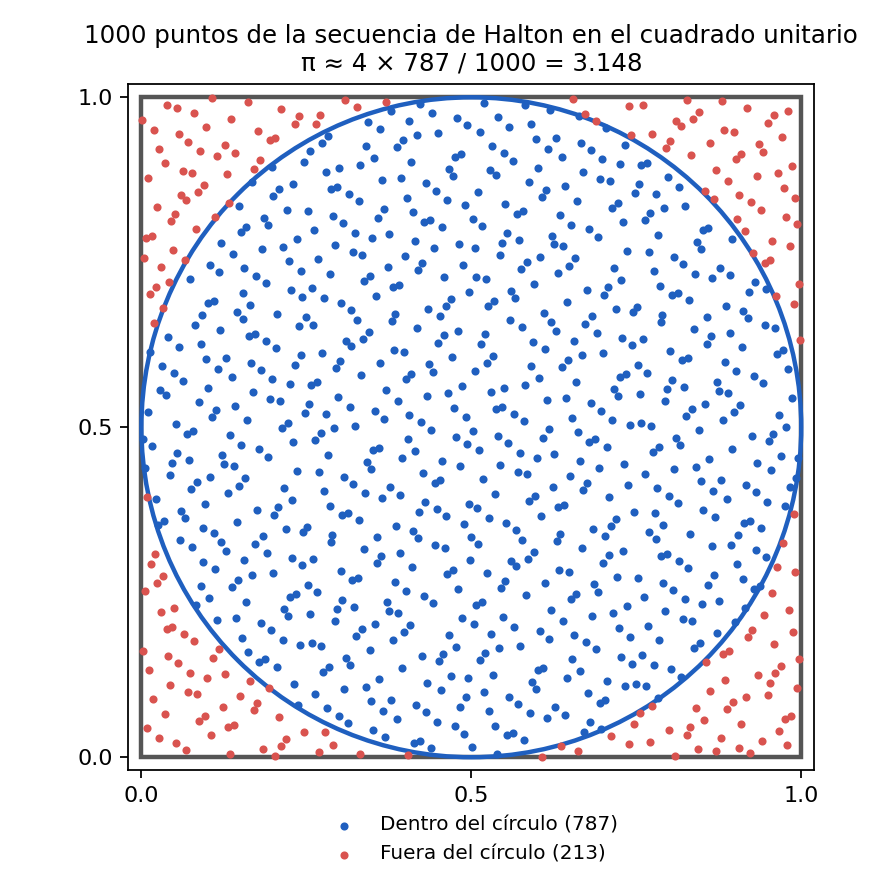
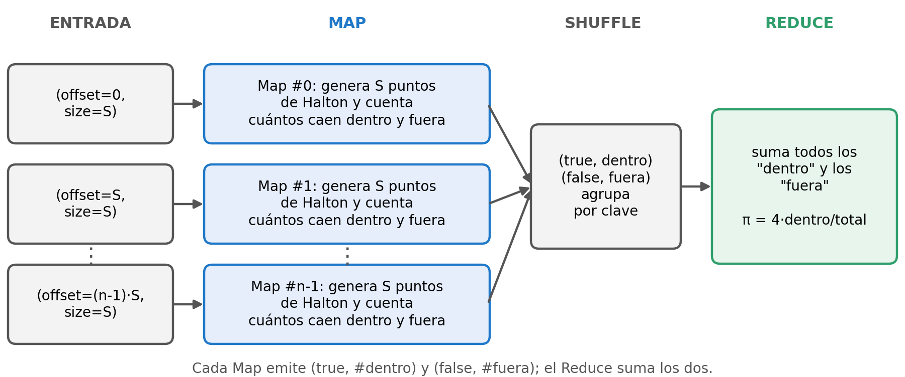
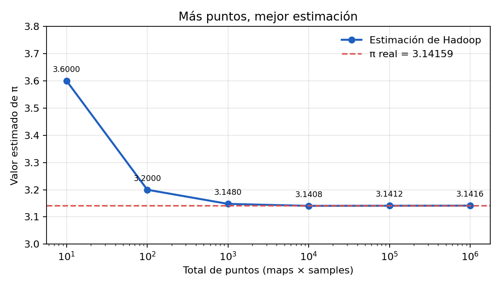

# Equipo 4: Pi por Monte Carlo (`pi`)

Ejemplo de MapReduce que estima el valor de **π** con puntos en un cuadrado. Esta guía permite reproducir todo paso a paso, en **Windows** o **Linux**, usando solo este README.

> 💻 = comando que se escribe **en tu computadora** · 🐳 = comando que se escribe **dentro del contenedor** `hadoop`

## Integrantes

- Gustavo Adalid Catalan Carmen
- Valentín Almaraz Martínez
- Alberto Saúl Lopez Crespo

## Contenido del repositorio

```
.
├── README.md              ← esta guía
├── datos/                 ← (pi no usa archivos de entrada, ver datos/README.md)
├── scripts/
│   ├── ejecutar.sh        ← 🐳 todos los comandos de Hadoop, en orden
│   └── simular_pi.py      ← 💻 (opcional) réplica en Python para verificar los resultados sin Hadoop
├── resultados/            ← salida esperada y capturas
├── ejercicio/
│   ├── ejercicio.md       ← mini ejercicio para compañeros
│   └── solucion.md        ← solución
├── imagenes/              ← diagramas usados en este README
├── presentacion.pdf       ← diapositivas
└── presentacion.pptx      ← diapositivas editables
```

---

## 1. ¿Qué hace el ejemplo `pi`?

Calcula una **aproximación de π**. Se imagina un cuadrado de lado 1 con un círculo inscrito (radio 0.5). El área del círculo es π · 0.5² = **π/4**, así que la fracción de puntos que cae dentro del círculo se acerca a π/4:

```
π ≈ 4 × (puntos dentro del círculo) / (puntos totales)
```



**Caso real donde serviría:** la misma idea, estimar un valor lanzando muchísimas muestras independientes, se usa en simulaciones de Monte Carlo para valuar opciones financieras, calcular riesgos, simular el transporte de partículas en física o estimar probabilidades complejas[cite: 15]. Como cada muestra es independiente, el trabajo se reparte muy bien entre muchas máquinas, y por eso es un ejemplo clásico para MapReduce.

> **Aclaración importante:** el `pi` de Hadoop no usa números aleatorios[cite: 15]. Usa un método **cuasi-Monte Carlo**: los puntos vienen de la **secuencia de Halton** (bases 2 y 3), que cubre el cuadrado de forma muy uniforme y es **determinista**. Por eso, con los mismos parámetros **siempre da exactamente el mismo resultado**, algo que usaremos para comprobar la reproducibilidad.

## 2. ¿Cómo funciona? (Map y Reduce)

El programa se ejecuta así: `pi <nMaps> <nSamples>` (cuántos mappers y cuántos puntos genera cada uno).



| Fase | Qué entra | Qué hace | Qué sale |
|---|---|---|---|
| **Entrada** | Hadoop crea `nMaps` archivos pequeños[cite: 15] | Cada uno guarda un par `(offset, size)` con `offset = i · nSamples` y `size = nSamples` | `(offset, size)` por mapper |
| **Map** | `(offset, size)` | Genera los puntos de la secuencia de Halton desde el número `offset+1` hasta `offset+size` y cuenta cuántos caen dentro y fuera del círculo | `(true, nDentro)` y `(false, nFuera)` |
| **Shuffle** | Los pares de todos los mappers | Agrupa por clave (`true` / `false`) | `true → [n₀, n₁, …]`, `false → [m₀, m₁, …]` |
| **Reduce** | Las listas de cada clave | Suma todos los "dentro" y todos los "fuera" y guarda los totales en un archivo temporal | `(totalDentro, totalFuera)` |
| **Final** | Los totales | El programa principal calcula `4 · totalDentro / (nMaps · nSamples)` y lo imprime | `Estimated value of Pi is …` |

**Mini ejemplo con `pi 2 5`** (10 puntos en total):

- Map #0 procesa los puntos 1 a 5 de la secuencia: los 5 caen dentro → emite `(true, 5)` y `(false, 0)`.
- Map #1 procesa los puntos 6 a 10: 4 caen dentro y 1 fuera → emite `(true, 4)` y `(false, 1)`.
- Reduce suma: dentro = 5 + 4 = **9**, fuera = 0 + 1 = 1.
- π ≈ 4 · 9 / 10 = **3.6**. Con tan pocos puntos la estimación es mala, pero con más puntos mejora.

Notas:

- Como el reparto usa `offset`, cada mapper trabaja con un tramo distinto de la misma secuencia. Por eso el resultado solo depende del **total** de puntos (`nMaps × nSamples`), no de cómo se reparten.
- `pi` **no deja una carpeta de salida con `part-r-00000`**: imprime el resultado en pantalla y borra su carpeta temporal `QuasiMonteCarlo_*` al terminar (igual que `sudoku` en la práctica).
- En modo standalone (nuestro contenedor) los maps se ejecutan en una sola máquina, normalmente uno tras otro. En un clúster real correrían en paralelo en varios nodos.



---

## 3. Requisitos

- **Docker** instalado y en ejecución en tu computadora.
- **Git** para clonar este repositorio.

| | 🪟 Windows 10/11 | 🐧 Linux (Fedora / Debian / Ubuntu) |
|---|---|---|
| Terminal recomendada | PowerShell (o la terminal integrada de VS Code)[cite: 15] | Terminal bash[cite: 15] |
| Instalar Docker | `winget install -e --id Docker.DockerDesktop` (abrir **Docker Desktop** hasta ver *Engine running*)[cite: 15] | `sudo dnf install docker-ce` (Fedora) o `sudo apt install docker.io` (Debian/Ubuntu)[cite: 15] |
| Permisos de Docker | Automático con Docker Desktop | `sudo usermod -aG docker $USER && newgrp docker` |
| Instalar Git | `winget install -e --id Git.Git`[cite: 15] | `sudo dnf install git` o `sudo apt install git`[cite: 15] |
| Comprobar | `docker ps` y `git --version` | `docker ps` y `git --version` |

---

## 4. Paso a paso

### Paso 1 💻: clonar el repositorio

```bash
git clone https://github.com/gustavoadalid1-debug/EP.02.02.-Exposiciones-por-equipos-Ejemplos-de-MapReduce-Gustavo-Valentin-Saul-.git bda-equipo-4-pi
cd bda-equipo-4-pi
```
[cite: 15]

Todos los comandos con el ícono 💻 deben ejecutarse desde la carpeta `bda-equipo-4-pi`[cite: 15].

---

### Paso 2 💻: encender o crear el contenedor

Comprueba si ya tienes el contenedor creado[cite: 15]:

```bash
docker ps -a
```
[cite: 15]

#### Opción A: Si ya tienes el contenedor de una práctica previa
Si en la columna `NAMES` aparece `hadoop`, simplemente inícialo si está apagado[cite: 15]:

```bash
docker start hadoop
```
[cite: 15]

#### Opción B: Si estás en una computadora limpia (crear el entorno desde cero)
Para evitar incompatibilidades entre sistemas operativos o versiones obsoletas de repositorios, crea el contenedor e instala las dependencias directamente como `root`[cite: 16]:

1. **Crear y levantar el contenedor base:**
   ```bash
   docker run -dit --name hadoop debian:bullseye bash
   ```

2. **Entrar al contenedor como root:**
   ```bash
   docker exec -it -u root hadoop bash
   ```

3. **Dentro del contenedor (`root@...:/#`), copia y pega este bloque para configurar repositorios históricos e instalar paquetes:**
   ```bash
   echo 'Acquire::Check-Valid-Until "false";' > /etc/apt/apt.conf.d/99no-check-valid-until
   cat << 'EOF' > /etc/apt/sources.list
   deb [http://archive.debian.org/debian](http://archive.debian.org/debian) bullseye main contrib non-free
   deb [http://archive.debian.org/debian-security](http://archive.debian.org/debian-security) bullseye-security main contrib non-free
   EOF
   apt-get update
   apt-get install -y --no-install-recommends openjdk-11-jdk-headless wget procps ca-certificates
   ```

4. **Instalar Hadoop 3.3.6 y crear el usuario:**
   ```bash
   useradd -m -s /bin/bash hadoop
   cd /opt
   wget [https://archive.apache.org/dist/hadoop/common/hadoop-3.3.6/hadoop-3.3.6.tar.gz](https://archive.apache.org/dist/hadoop/common/hadoop-3.3.6/hadoop-3.3.6.tar.gz)
   tar -xzf hadoop-3.3.6.tar.gz
   mv hadoop-3.3.6 hadoop
   rm hadoop-3.3.6.tar.gz
   chown -R hadoop:hadoop /opt/hadoop
   ```

5. **Configurar las variables de entorno del usuario `hadoop` y salir:**
   ```bash
   cat << 'EOF' >> /home/hadoop/.bashrc
   export JAVA_HOME=/usr/lib/jvm/java-11-openjdk-amd64
   export HADOOP_HOME=/opt/hadoop
   export PATH=$PATH:$HADOOP_HOME/bin:$HADOOP_HOME/sbin
   EOF
   exit
   ```

---

### Paso 3 💻 → 🐳: comprobar la versión de Hadoop

```bash
docker exec -u hadoop hadoop hadoop version
```
[cite: 15]

Debe empezar confirmando `Hadoop 3.3.6`[cite: 15].

---

### Paso 4 💻: copiar el script al contenedor

Crea la carpeta de trabajo, transfiere el script y asigna los permisos necesarios[cite: 15]:

```bash
docker exec -u root hadoop mkdir -p /tmp/equipo4
docker cp scripts/ejecutar.sh hadoop:/tmp/equipo4/ejecutar.sh
docker exec -u root hadoop chown -R hadoop:hadoop /tmp/equipo4
```
[cite: 15]

---

### Paso 5 🐳: ejecutar el ejemplo dentro del contenedor

Abre la terminal dentro del contenedor **como usuario `hadoop`**[cite: 15]:

```bash
docker exec -it -u hadoop hadoop bash
```
[cite: 15]

El prompt mostrará `hadoop@...:~$`[cite: 15]. Ahora ejecuta:

#### Opción A: Ejecutar todo con el script automatizado (recomendada)
```bash
bash /tmp/equipo4/ejecutar.sh
```
[cite: 15]

El script corre `pi` con las combinaciones de mappers y muestras, guardando el concentrado en `/tmp/equipo4/resumen.txt` y los registros detallados en `/tmp/equipo4/logs/`[cite: 4, 15].

#### Opción B: Ejecutar una sola vez a mano
```bash
hadoop jar $HADOOP_HOME/share/hadoop/mapreduce/hadoop-mapreduce-examples-3.3.6.jar pi 10 1000
```
[cite: 15]

Para salir del contenedor cuando termine: escribe `exit` (el contenedor se mantiene encendido)[cite: 15].

---

### Resultado esperado

Al final de cada trabajo de MapReduce se imprime la estimación[cite: 15]:

```
Number of Maps  = 10
Samples per Map = 1000
Wrote input for Map #0
Wrote input for Map #1
...
Wrote input for Map #9
Starting Job
Job Finished in N seconds
Estimated value of Pi is 3.14080000000000000000
```
[cite: 15]

Tabla completa de valores teóricos y de referencia[cite: 15]:

| Comando | Total de puntos | π estimado | Error absoluto |
|---|---:|---|---:|
| `pi 2 5` | 10 | 3.60000000000000000000 | 0.458 |
| `pi 10 10` | 100 | 3.20000000000000000000 | 0.058 |
| `pi 10 100` | 1 000 | 3.14800000000000000000 | 0.0064 |
| `pi 10 1000` | 10 000 | 3.14080000000000000000 | 0.00079 |
| `pi 10 10000` | 100 000 | 3.14120000000000000000 | 0.00039 |
| `pi 10 100000` | 1 000 000 | 3.14155200000000000000 | 0.000041 |
| `pi 16 1000` | 16 000 | 3.14250000000000000000 | 0.00091 |
| `pi 16 1000000` (opcional) | 16 000 000 | 3.14159125000000000000 | 0.0000014 |
[cite: 15]

---

### Paso 6 💻: copiar los resultados a tu computadora

Desde la terminal de tu computadora (fuera del contenedor)[cite: 15]:

```bash
docker cp hadoop:/tmp/equipo4/resumen.txt resultados/resumen_obtenido.txt
docker cp hadoop:/tmp/equipo4/logs resultados/
```
[cite: 15]

---

### Paso 7 💻: comparar con lo esperado

Comprueba que tus resultados coincidan exactamente con el valor determinista[cite: 15]:

🪟 **Windows (PowerShell):**
```powershell
Compare-Object (Get-Content resultados/resumen_esperado.txt) (Get-Content resultados/resumen_obtenido.txt)
```
[cite: 15]
*(Si no imprime texto en consola, los archivos son idénticos)*[cite: 15].

🐧 **Linux:**
```bash
diff resultados/resumen_esperado.txt resultados/resumen_obtenido.txt && echo "IGUALES"
```
[cite: 15]

---

### Opcional A 🐳: ejecución grande (16 millones de puntos)

Dentro del contenedor, añade el argumento `grande`[cite: 15]:

```bash
bash /tmp/equipo4/ejecutar.sh grande
```
[cite: 15]

---

### Opcional B 💻: verificar sin Hadoop

`scripts/simular_pi.py` replica el cálculo matemático en Python puro sin dependencias externas[cite: 15]:

🪟 **Windows:** `py scripts/simular_pi.py 10 1000` *(o `python scripts/simular_pi.py 10 1000` si tu PATH está configurado)*[cite: 15]  
🐧 **Linux:** `python3 scripts/simular_pi.py 10 1000`[cite: 15]

---

## 5. Mini ejercicio

En la carpeta [`ejercicio/`](ejercicio/): `ejercicio.md` (planteamiento) y `solucion.md` (solución paso a paso)[cite: 15].

---

## 6. Errores comunes

| Error | Causa | Solución |
|---|---|---|
| `permission denied while trying to connect to the docker API at unix:///var/run/docker.sock` (Linux)[cite: 21] | El usuario actual de Linux no pertenece al grupo `docker`[cite: 21]. | Ejecuta `sudo usermod -aG docker $USER && newgrp docker` para otorgar acceso sin necesidad de usar `sudo`[cite: 21]. |
| `syntax error near unexpected token '('` al clonar o descargar[cite: 20, 22] | Se copió la URL envuelta en sintaxis Markdown tipo `[link](url)`[cite: 20, 22]. | Copia y pega únicamente la URL limpia sin paréntesis ni corchetes[cite: 20]. |
| `No such container: hadoop` al ejecutar `docker start hadoop`[cite: 1] | El contenedor aún no existe en esa máquina[cite: 1]. | Realiza la instalación limpia descrita en la **Opción B del Paso 2**. |
| `E: Failed to fetch ... 404 Not Found` al ejecutar `apt-get install`[cite: 16, 18] | Debian Bullseye pasó al repositorio de archivos históricos[cite: 18]. | Apunta `/etc/apt/sources.list` hacia `http://archive.debian.org/debian` tal como se indica en el Paso 2[cite: 18]. |
| En Windows `python` abre la Microsoft Store o muestra `Python was not found`[cite: 4] | Los "Alias de ejecución de aplicaciones" de Windows interceptan el comando[cite: 4]. | Ejecuta el script usando `py scripts/simular_pi.py` o deshabilita los alias en la configuración del sistema[cite: 4, 15]. |
| `failed to connect to the docker API at npipe:////./pipe/dockerDesktopLinuxEngine` (Windows)[cite: 15] | Docker Desktop no está en ejecución[cite: 15]. | Inicia Docker Desktop y espera a que el estado indique *Engine running*[cite: 15]. |
| `bash: /tmp/equipo4/ejecutar.sh: /bin/bash^M: bad interpreter`[cite: 15] | El archivo fue guardado con finales de línea CRLF de Windows[cite: 15]. | Corre dentro del contenedor: `sed -i 's/\r$//' /tmp/equipo4/ejecutar.sh`[cite: 15]. |
| `Permission denied` al escribir en `/tmp/equipo4`[cite: 15] | Faltó transferir los permisos al usuario `hadoop`[cite: 15]. | Ejecuta `docker exec -u root hadoop chown -R hadoop:hadoop /tmp/equipo4`[cite: 15]. |
| `Tmp directory … already exists` o quedó una carpeta `QuasiMonteCarlo_*`[cite: 15] | Se canceló abruptamente una simulación previa con Ctrl+C[cite: 15]. | Limpia el directorio temporal con: `rm -rf /tmp/equipo4/QuasiMonteCarlo_*` dentro del contenedor[cite: 15]. |

---

## 7. Presentación

Las diapositivas están en [`presentacion.pdf`](presentacion.pdf) (y la versión editable en [`presentacion.pptx`](presentacion.pptx))[cite: 15].
